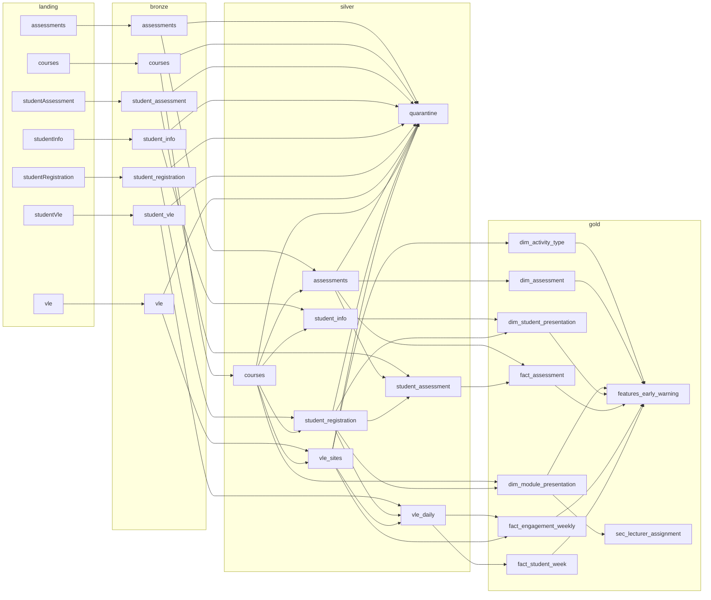

# Lineage

Personal portfolio project; not affiliated with or endorsed by ITE or the Open University.

<!-- Generated by scripts/build_docs.py from the SQL files. Edit docs/templates/lineage.md instead. -->

Table-level lineage, read from the SQL: each transformation is one SELECT, and the tables it names are its inputs.
Every run also writes the same information as events in the OpenLineage run-event shape (one JSON file per run under
`<lake>/_events/lineage/`), with the output schema and row count; the tests validate those events against the
OpenLineage 2-0-2 JSON schema.

What this is not: there is no column-level lineage, and no OpenLineage backend (such as Marquez) was run. The events
are files.

| Table | Reads from |
|---|---|
| `bronze.courses` | `landing.courses` |
| `bronze.assessments` | `landing.assessments` |
| `bronze.vle` | `landing.vle` |
| `bronze.student_info` | `landing.studentInfo` |
| `bronze.student_registration` | `landing.studentRegistration` |
| `bronze.student_assessment` | `landing.studentAssessment` |
| `bronze.student_vle` | `landing.studentVle` |
| `silver.assessments` | `bronze.assessments`, `silver.courses` |
| `silver.courses` | `bronze.courses` |
| `silver.quarantine` | `bronze.courses`, `bronze.assessments`, `silver.courses`, `bronze.vle`, `bronze.student_registration`, `bronze.student_info`, `bronze.student_assessment`, `silver.assessments`, `silver.student_registration`, `bronze.student_vle`, `silver.vle_sites` |
| `silver.student_assessment` | `bronze.student_assessment`, `silver.assessments`, `silver.student_registration` |
| `silver.student_info` | `bronze.student_info`, `silver.courses` |
| `silver.student_registration` | `bronze.student_registration`, `silver.courses` |
| `silver.vle_daily` | `bronze.student_vle`, `silver.vle_sites`, `silver.student_registration` |
| `silver.vle_sites` | `bronze.vle`, `silver.courses` |
| `gold.dim_activity_type` | `silver.vle_sites` |
| `gold.dim_assessment` | `silver.assessments` |
| `gold.dim_module_presentation` | `silver.courses`, `silver.student_registration` |
| `gold.dim_student_presentation` | `silver.student_registration`, `silver.student_info` |
| `gold.dim_week` |  |
| `gold.fact_assessment` | `silver.student_assessment`, `silver.assessments` |
| `gold.fact_engagement_weekly` | `silver.vle_daily`, `silver.vle_sites` |
| `gold.fact_student_week` | `silver.vle_daily` |
| `gold.sec_lecturer_assignment` | `gold.dim_module_presentation` |
| `gold.features_early_warning` | `gold.dim_student_presentation`, `gold.fact_student_week`, `gold.fact_engagement_weekly`, `gold.dim_activity_type`, `gold.dim_assessment`, `gold.fact_assessment`, `gold.dim_module_presentation` |

Downstream of gold, outside the lake: `scripts/export_dashboard.py` reads gold through the management access views
and writes `dashboard/data/*.csv`, which the Power BI model and the static preview read.
